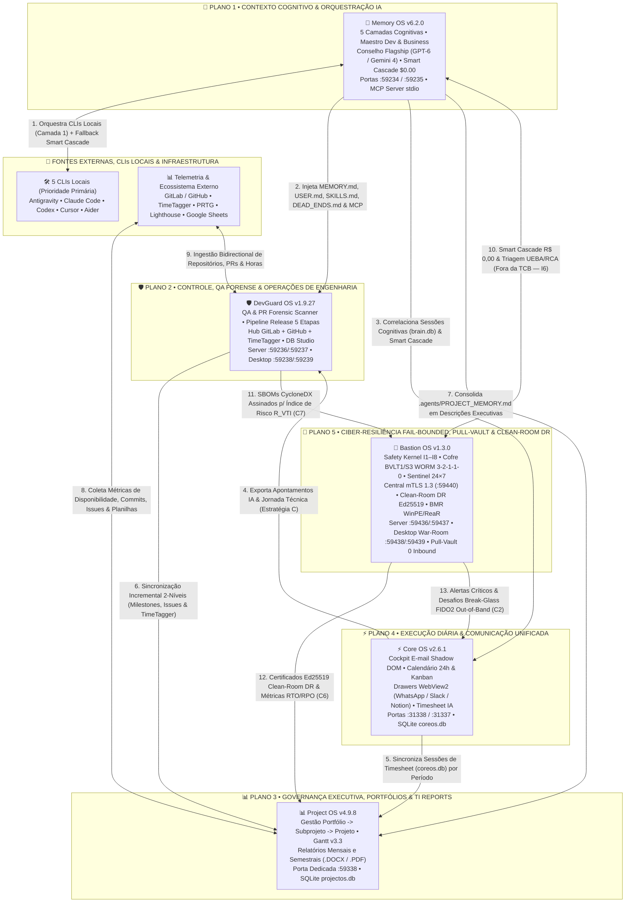

# 🌐 VTI OS SYSTEM — Enterprise AI-Native Software Engineering, Cognitive Memory & Governance Ecosystem

> **Plataforma Corporativa Integrada em Malha Fechada para Engenharia de Software Assistida por IA, Memória Cognitiva Perene, Governança Técnica Zero-Trust, Gestão Executiva de Portfólios e Produtividade de Alta Performance.**
>
> **Propriedade Intelectual & Engenharia:** **VTI** • *Edição Corporativa Consolidada (2026)*

---

## 📋 Visão Geral Institucional

O **VTI OS SYSTEM** é a infraestrutura proprietária de engenharia de software e governança corporativa desenvolvida pela **VTI** para erradicar a fragmentação operacional, a perda de contexto cognitivo e o risco de conformidade em equipes técnicas e executivas de alta performance.

Em operações modernas de tecnologia, engenheiros, arquitetos e executivos enfrentam um abismo estrutural entre cinco mundos desconectados:
1. **O Ambiente de Execução Diária** (e-mails, reuniões, mensageria instantânea, tarefas e apontamento de horas);
2. **O Ambiente de Inteligência Artificial & IDEs** (agentes autônomos e LLMs que sofrem de amnésia entre sessões, alucinam contratos e repetem erros já resolvidos);
3. **O Ambiente de Controle de Qualidade, Git & Segurança** (repositórios, PRs, auditorias de vulnerabilidade, compliance e releases);
4. **O Ambiente de Governança Executiva & SLAs** (portfólios PMBOK/Agile, prestação de contas, faturamento de horas e relatórios gerenciais de TI);
5. **O Ambiente de Ciber-Resiliência, Cofres Imutáveis & Continuidade Operacional** (defesa ativa contra ransomware/extorsão, backups *Pull-Only* à prova de comprometimento local, auditoria forense e recuperação *Bare-Metal*/*Clean-Room DR*).

O **VTI OS SYSTEM** unifica esses cinco domínios em uma **arquitetura de malha fechada (*Closed-Loop Governance*)**, onde cada sessão de trabalho, commit, decisão arquitetural, revisão de código e apontamento de horas retroalimenta automaticamente o ecossistema — mantendo **100% de soberania local de dados (*Local-First*)**, **auditoria criptográfica** e **otimização inteligente de custos de IA (`$0.00` Free-Tier Cascade + Prioridade Universal às CLIs locais)**.

---

## 🧭 Os 5 Planos Arquiteturais do Ecossistema VTI

| Plano Arquitetural | Sistema VTI | Versão Atual | Papel no Ecossistema (*System-of-Record*) | Portas & Runtime Nativo |
| :--- | :--- | :---: | :--- | :--- |
| **1. Plano de Contexto, Memória Cognitiva & Orquestração Multi-Agente** | **🧠 Memory OS** | `v6.2.0` | Memória neuro-cognitiva bitemporal de duplo eixo (`5+1 Camadas` + `Keith E. Stanovich`), Divisão Científica **`VTI Research`**, Conselho Flagship Multi-Modelo, `Maestro Dev & Business`, Live Mission Control & Copilot. | Frontend `:59234` Backend `:59235` MCP `stdio JSON-RPC 2.0` |
| **2. Plano de Controle, QA Forense, Segurança & Operações Git** | **🛡️ DevGuard OS** | `v1.9.27` | Governança contínua de repositórios, Scanner Forense de PR/Branch, Supply-Chain Security, Orquestração Híbrida (`GitLab` + `GitHub` + `TimeTagger` + `Core OS`) e Gatekeeper de Release. | Server `:59236` / `:59237` Desktop `:59238` / `:59239` Tauri v2 + Docker Swarm |
| **3. Plano de Governança Executiva, Portfólios & Relatórios de TI** | **📊 Project OS** | `v4.9.8` | Gestão executiva (`Portfólio -> Subprojeto -> Projeto`), Sincronização Incremental em 2 Níveis com DevGuard/CoreOS/MemoryOS e geração automatizada de Relatórios Mensais/Semestrais de TI (`.docx`/`.pdf`). | Desktop & API `:59338` Tauri v2 + WebView2 SQLite `projectos.db` |
| **4. Plano de Execução Diária, Comunicação Unificada & Timesheet IA** | **⚡ Core OS** | `v2.6.1` | Cockpit executivo *Keyboard-First* com E-mail Superhuman (Shadow DOM), Calendário 24h, Drawers Nativos WebView2 (WhatsApp/Slack/Notion) e Timesheet Inteligente correlacionado por IA. | Frontend `:31338` Backend + WS `:31337` Tauri v2 + WebView2 |
| **5. Plano de Ciber-Resiliência Fail-Bounded, Cofre Imutável Pull-Only & Clean-Room DR** | **🏰 Bastion OS** | `v1.3.0` | Plataforma autônoma de defesa ativa (*Safety Kernel* $I_1$–$I_8$, 13 controles $C_1$–$C_{13}$), Cofre `BVLT1`/`FASTCDC_NC2` & `3-2-1-1-0` S3 WORM, Central de Servidores `mTLS 1.3`, *Living Decoy Mesh*, *Clean-Room DR* `Ed25519`, *Bare-Metal* (`WinPE`/`ReaR`) e *War-Room Offline* (`SQLCipher 4`). | Server `:59436` / `:59437` Desktop `:59438` / `:59439` mTLS `:59440` • Pull-Vault `0 Inbound` |

---

## 🏛️ Diagrama Arquitetural e Fluxo de Governança em Malha Fechada

---

## 🔬 Divisão Científica `VTI Research` — Publicações, Executive Briefs & DOIs Oficiais (CERN / Zenodo)

* **Portal Científico Público (Bilíngue EN/PT • Indexado p/ Google Scholar):** [`https://projectos-system.github.io/vti-research/`](https://projectos-system.github.io/vti-research/)
* **Repositório Aberto de Manuscritos, PDFs & Pacotes LaTeX/BibTeX:** [`ProjectOS-system/vti-research`](https://github.com/ProjectOS-system/vti-research)
* **Subdomínio Nativo In-App:** Integrado diretamente ao **`Memory OS v6.2.0`** (menu lateral **`VTI Research`**, evoluindo a antiga seção de *Pilares Acadêmicos*)
* **Investigador Principal & Autor:** **Caio Gonçalves** — *Principal Investigator & Chief Systems Architect, VTI Research (VTI, Brazil)* (`COPE / ICMJE / ACM / IEEE / arXiv 2026 Compliant`)

A **VTI Research** é o braço oficial de pesquisa científica, formalização matemática e engenharia experimental da **VTI**. Cada investigação é publicada em **Inglês (`en-US`)** e **Português (`pt-BR`)**, com separação estrita entre **Documento 1 (*Executive Brief* para tomada de decisão C-Level e ROI)** e **Documento 2 (*Scientific Paper* completo diagramado em dupla coluna padrão IEEE/ACM/arXiv com fontes LaTeX + BibTeX)**, devidamente anonimizada e registrada com **DOI oficial permanente via CERN / Zenodo (DataCite)**:

| Código | Publicação Científica & Executive Brief (`EN-US` / `PT-BR`) | Domínio / arXiv | DOI Oficial (CERN / Zenodo) | Artefatos Públicos |
| :---: | :--- | :---: | :---: | :--- |
| **`VTI-RES-2026-01`** | **Cognitive Harness Engineering, Sub-Parametric Overthinking, and Human-AI Symbiosis:** *Non-Compensatory Conditioned Parity in High-Stakes Compound Agentic Systems* Experimento pareado $5 \times 20 = 100$ execuções revelando o fenômeno de *Sub-Parametric Overthinking* e formalizando os 8 modelos (`M1–M8`) do `HPE v3.0` com redução de `80%–95%` em custo. | `cs.AI` `cs.SE` `cs.CY` | [**`10.5281/zenodo.24290282`**](https://doi.org/10.5281/zenodo.24290282) | [Portal](https://projectos-system.github.io/vti-research/papers/VTI-RES-2026-01/) • [Paper EN](https://projectos-system.github.io/vti-research/pdf/VTI-RES-2026-01_Paper_EN.pdf) • [Paper PT](https://projectos-system.github.io/vti-research/pdf/VTI-RES-2026-01_Paper_PT.pdf) • [Brief EN](https://projectos-system.github.io/vti-research/pdf/VTI-RES-2026-01_Executive_Brief_EN.pdf) • [Brief PT](https://projectos-system.github.io/vti-research/pdf/VTI-RES-2026-01_Executive_Brief_PT.pdf) • [LaTeX `.zip`](https://projectos-system.github.io/vti-research/latex/VTI-RES-2026-01_LaTeX_Source.zip) |
| **`VTI-RES-2026-02`** | **Dual-Axis Bitemporal Neuro-Cognitive Architecture and Tripartite Epistemic Governance for Long-Horizon Autonomous Agents (`MemoryOS`)** Formaliza as `5+1` camadas de memória (Snodgrass bitemporal + Tarjan SCC $O(V+E)$ + Merkle SHA-256) e os 3 anéis metacognitivos de Keith E. Stanovich (`NDCG@5: 0,5764 -> 1,0000`, `P95 = 0,34 ms`). | `cs.AI` `cs.IR` | [**`10.5281/zenodo.24290284`**](https://doi.org/10.5281/zenodo.24290284) | [Portal](https://projectos-system.github.io/vti-research/papers/VTI-RES-2026-02/) • [Paper EN](https://projectos-system.github.io/vti-research/pdf/VTI-RES-2026-02_Paper_EN.pdf) • [Paper PT](https://projectos-system.github.io/vti-research/pdf/VTI-RES-2026-02_Paper_PT.pdf) • [Brief EN](https://projectos-system.github.io/vti-research/pdf/VTI-RES-2026-02_Executive_Brief_EN.pdf) • [Brief PT](https://projectos-system.github.io/vti-research/pdf/VTI-RES-2026-02_Executive_Brief_PT.pdf) • [LaTeX `.zip`](https://projectos-system.github.io/vti-research/latex/VTI-RES-2026-02_LaTeX_Source.zip) |
| **`VTI-RES-2026-03`** | **Formal Blast-Radius Containment, Zero-Breakage Credential Rotation, and Epistemic Zero-Trust Isolation in Enterprise Multi-Agent Ecosystems** Formula 8 hipóteses acopladas de ameaça (`H1–H8`) e prova 8 controles *fail-closed* (`C1–C8`: `/run/secrets`, RFC 9700, OSC-52, JCS + Ed25519, Fencing Tokens ACID e Crypto-Shredding Mod-11). | `cs.CR` `cs.SE` `cs.AI` | [**`10.5281/zenodo.24290286`**](https://doi.org/10.5281/zenodo.24290286) | [Portal](https://projectos-system.github.io/vti-research/papers/VTI-RES-2026-03/) • [Paper EN](https://projectos-system.github.io/vti-research/pdf/VTI-RES-2026-03_Paper_EN.pdf) • [Paper PT](https://projectos-system.github.io/vti-research/pdf/VTI-RES-2026-03_Paper_PT.pdf) • [Brief EN](https://projectos-system.github.io/vti-research/pdf/VTI-RES-2026-03_Executive_Brief_EN.pdf) • [Brief PT](https://projectos-system.github.io/vti-research/pdf/VTI-RES-2026-03_Executive_Brief_PT.pdf) • [LaTeX `.zip`](https://projectos-system.github.io/vti-research/latex/VTI-RES-2026-03_LaTeX_Source.zip) |
| **`VTI-RES-2026-04`** (`v3.0`) | **Asymmetrically Bounded Cyber Resilience, Zero-Inbound Remote Containment, Non-TCB Cognitive Triage, and Multi-Cloud Immutable Vaults in Critical Infrastructures** Edição consolidada `v3.0` verificada em código executável (`Bastion OS v1.3.0`: `301` backend + `254` E2E + `B1–B20`): `BASTION-FLEET-CMD-V3` (`Bastion Approver` `2-de-3` + `ES256` TPM), Copiloto IA LGPD Zero-Egress fora da TCB ($I_6$), `BVLT1`/`BVPK1` + Google Drive Dual-Auth, Higiene Anti-`ENOSPC` `O(1)` e 63 fontes primárias. | `cs.CR` `cs.DC` `cs.SE` `cs.OS` | [**`10.5281/zenodo.24452820`**](https://doi.org/10.5281/zenodo.24452820) Concept: [`24406145`](https://doi.org/10.5281/zenodo.24406145) | [Portal](https://projectos-system.github.io/vti-research/papers/VTI-RES-2026-04/) • [Paper EN](https://projectos-system.github.io/vti-research/pdf/VTI-RES-2026-04_Paper_EN.pdf) • [Paper PT](https://projectos-system.github.io/vti-research/pdf/VTI-RES-2026-04_Paper_PT.pdf) • [Brief EN](https://projectos-system.github.io/vti-research/pdf/VTI-RES-2026-04_Executive_Brief_EN.pdf) • [Brief PT](https://projectos-system.github.io/vti-research/pdf/VTI-RES-2026-04_Executive_Brief_PT.pdf) • [LaTeX `.zip`](https://projectos-system.github.io/vti-research/latex/VTI-RES-2026-04_LaTeX_Source.zip) |
| **`VTI-RES-2026-05`** (`v1.0`) | **Single-Pass Bounded-Memory Forensic Reconstruction of Multi-OS `[MS-VHDX]` Virtual Disks Under Intermittent Encryption: `GF(2)` Linear Checksum Decoupling, Ambiguity-Vetoed Bipartite Bijection, and Deterministic Boot Surgery** Formaliza $\mathcal{E}_{\mathrm{Rec}}$ (`7` operadores, `6` invariantes): `GF(2)` `CRC-32C` (`0/10.000` erros, `168,73x`), passagem única zero-seek-back, contabilidade 4-vias `ext4` (`F1=1,000`, `0/25` JSON FP), `MCMF` residual SPFA (`0/60` FAR), cirurgia `regf` (`20/20` sujas vetadas) e 28 fontes primárias. | `cs.CR` `cs.OS` `cs.DS` | [**`10.5281/zenodo.24452824`**](https://doi.org/10.5281/zenodo.24452824) | [Portal](https://projectos-system.github.io/vti-research/papers/VTI-RES-2026-05/) • [Paper EN](https://projectos-system.github.io/vti-research/pdf/VTI-RES-2026-05_Paper_EN.pdf) • [Paper PT](https://projectos-system.github.io/vti-research/pdf/VTI-RES-2026-05_Paper_PT.pdf) • [Brief EN](https://projectos-system.github.io/vti-research/pdf/VTI-RES-2026-05_Executive_Brief_EN.pdf) • [Brief PT](https://projectos-system.github.io/vti-research/pdf/VTI-RES-2026-05_Executive_Brief_PT.pdf) • [LaTeX `.zip`](https://projectos-system.github.io/vti-research/latex/VTI-RES-2026-05_LaTeX_Source.zip) |

## 📦 Repositórios Mestre do Ecossistema VTI

---

### 🧠 1. Memory OS — *Cognitive Memory Infrastructure, Multi-Agent Maestro Studio & Universal Intelligence Gateway*
* **Repositório:** [`MemoryOS`](https://github.com/ProjectOS-system/MemoryOS) | **Versão:** `v6.2.0 (Solo & Enterprise Swarm • Arquitetura de Stanovich, Live Mission Control & VTI Research)`
* **Propósito:** Infraestrutura de memória cognitiva cumulativa em 5 camadas neuro-inspiradas, combinada a um Gateway Universal de Inteligência Artificial e ao **Maestro Studio Dual-Mode** para orquestração autônoma de desenvolvimento de software e operações corporativas críticas.

#### 🔬 Arquitetura Cognitiva em 5 Camadas (Neurociência em Código):
1. **Memória de Trabalho (Working Memory — Córtex Pré-Frontal):** Contexto ativo com *Pre-Compress Insight Extraction* antes da compactação de tokens e **Compressão Stacked em Duplo Estágio** (`Terminal Log Pruner` + `Semantic Prose Compressor pt-BR` com sentinela `\u0000MOS_PRESERVE`).
2. **Memória Episódica (Subconsciente — Hipocampo):** Repositório append-only em SQLite (`brain.db` WAL) com **Busca Híbrida RRF 4-Vias (Reciprocal Rank Fusion)** combinando Léxico **FTS5 BM25**, Semântico Vetorial Local **ONNX (`all-MiniLM-L6-v2` 384d)**, Grafo Relacional **GraphRAG (`memory_relations` BFS)** e Tríade de Relevância Temporal de Stanford (Park et al.):
   $$\text{FinalScore} = \text{BM25} \cdot \left( \frac{1}{1 + 0.05 \cdot \text{dias}} \right) \cdot \text{ImportanceScore}$$
3. **Memória Semântica (Neocórtex / Consolidação Noturna):** Conhecimento perene destilado em `USER.md` e `MEMORY.md`, com log bi-temporal `fact_history`, *Write Approval Gate* (`pending_writes`), *Drift Detection* (`SHA-256`) e *Threat Pattern Scanning* contra Prompt Injection e Memory Poisoning.
4. **Memória Ambiental (Memória Implícita por Projeto):** Injeção determinística via `.agents/PROJECT_MEMORY.md` na raiz de cada repositório e bloqueio ativo de regressões via `DEAD_ENDS.md`.
5. **Memória Procedimental (Cerebelo & Gânglios Basais):** Evolução autônoma de skills (`procedural_skills` $\rightarrow$ `SKILLS.md`) e exposição nativa via **Servidor MCP (`mcp_server.js`)** com **17 ferramentas** em protocolo `stdio JSON-RPC 2.0`.

#### ✨ Principais Diferenciais e Funcionalidades (`v6.2.0`):
* **Divisão Científica `VTI Research` Integrada (Subdomínio Oficial & Enciclopédia de 32 Estudos):** Evolução do módulo acadêmico para o hub **`VTI Research`** dentro do Memory OS (`AcademicPillarsPage.jsx`), disponibilizando leitura in-app bilíngue (`PT-BR` / `EN-US`), PDFs diagramados em dupla coluna (`IEEE/ACM/arXiv`), *Executive Briefs*, pacotes `LaTeX + BibTeX` e **5 DOIs Oficiais registrados no CERN / Zenodo**, sincronizado com o portal público indexável pelo Google Scholar (`https://projectos-system.github.io/vti-research/`).
* **Universal Intelligence Gateway & Conselho Flagship Multi-Modelo (`Human-in-the-Loop v5.1`):** Ferramentas nativas `ai_consult_council`, `ai_dual_code_review` (com injeção obrigatória de `DEAD_ENDS.md` e vereditos estritos) e `ai_adversarial_test_gen`, integrando **OpenAI GPT-6 Flagship** (`gpt-6-luna`, `gpt-6-sol`, `gpt-6.1-sol`, `gpt-6-astra`) e **Google Gemini 4 / 3.8** (`gemini-4-argon`, `gemini-3.8-flash`, `gemini-3.7-flash`, `gemini-3.1-pro-preview`).
* **Módulo MemoryOS Maestro Studio (`Maestro Dev` & `Maestro Business`):**
  * **Prioridade Primária Universal às 5 CLIs Locais (`Camada 1`):** Tanto no modo Desenvolvedor quanto no Corporativo, o Maestro prioriza sempre as CLIs autenticadas localmente (`Google Antigravity CLI`, `Claude Code CLI`, `OpenAI Codex CLI`, `Cursor Agent CLI` e `Aider CLI`), com descoberta dinâmica de modelos reais (`state.vscdb`, `claude.exe`, `~/.codex/config.json`), Heartbeat OAuth pré-vôo (`< 100ms`), `Cumulative Phase Ledger`, Handoff Formal Idempotente e Checkpointing Git atômico.
  * **Visão `Maestro Dev`:** Cockpit de engenharia com 4 views (*Stream & Orquestração*, *Code & Diffs* com auditoria OWASP, *Swarm DAG AST Mesh*, *Time-Travel Checkpoints*), janelas cirúrgicas AST (`> 16 KB`) e motor nativo **`MemoryOS Surgical Code`** (`/surgical-code`, `/surgical-review`, `/surgical-audit`, `/surgical-debt`, `/surgical-metrics`).
  * **Visão `Maestro Business`:** Workspace corporativo Dual-Zone com *Live Document Canvas*, Cofres Efêmeros Governados (`Entrada_Segura/` para lotes de `500 MB` a `5 GB` com Watcher Anti-Lock), Briefing Executivo em Áudio MP3, *Shadow Auditor* com Manifesto Criptográfico `SHA-256 + HMAC-SHA256`, motor **DLP/LGPD** com validação matemática oficial **Módulo 11** (`CPF`/`CNPJ`) e Luhn (`Cartão`), e homologação completa em **27 Cenários Corporativos** (`12 Dev + 15 Business`).
* **`MemoryOS Smart Cascade` & Central Interativa de Chaves Gratuitas (`$0.00` — "Nosso OpenRouter"):**
  * Acionada automaticamente quando as quotas das CLIs locais se esgotam (`429`), por seleção explícita do usuário ou nas rotinas internas do Core.
  * Roteamento *Quality-Gated* em **4 Tiers (`S/A/B/C`)** com *Anti-Degradation Guard*, **45 provedores homologados** (`OpenRouter :free` / `openrouter/free`, `Groq Cloud LPU`, `Google AI Studio`, `Cerebras`, `GitHub Models`, `Ollama Local` sem chave), **Auto-Discovery ao vivo (`GET /models`)**, **Auto-Heal** de modelos descontinuados, fila priorizada (`Subir`/`Descer`) e monitor de telemetria em tempo real (*"Ver Sendo Usado"*).
* **27 Checks de Autodiagnóstico, Power-Aware Scheduler $O(1)$ (`v5.7.2`), Padrão Aberto OKF v0.3 & Cofre Obsidian:** Diagnóstico profundo de saúde em 1-clique, proteção contra disparo em cascata pós-hibernação do Windows e exportação nativa para grafos Markdown.

| Camada | Tecnologia | Porta / Contexto |
| :--- | :--- | :--- |
| **Frontend** | React 19 + Vite 8 | `59234` |
| **Backend Engine** | Node.js + Express 5 (`WriteQueue` + SSE) | `59235` |
| **Desktop Shell** | Tauri v2 Desktop Wrapper (Rust + WebView2) | Windows Native |
| **Database & Search** | SQLite3 (`brain.db` WAL + FTS5 + ONNX 384d + GraphRAG) | `~/.gemini/antigravity/brain/` |
| **Protocolo de Agentes** | Servidor MCP Nativo (`mcp_server.js` — 17 Tools) | `stdio JSON-RPC 2.0` |

---

### 🛡️ 2. DevGuard OS — *Autonomous Code Governance, Forensic PR Scanner, Hybrid Engineering Hub & Release Gatekeeper*
* **Repositório:** [`DevGuardOS`](https://github.com/ProjectOS-system/DevGuardOS) | **Versão:** `v1.9.27 (Dual-Instance: Server Cloud & Desktop Standalone)`
* **Propósito:** Plataforma autônoma de governança de código, auditoria forense de segurança/arquitetura, gestão híbrida de engenharia (`GitLab` + `GitHub` + `TimeTagger` + `Slack` + `CORE OS`) e automação segura de releases.

#### ✨ Principais Diferenciais e Funcionalidades (`v1.9.27`):
* **Arquitetura Dual-Instance (Cloud Server & Desktop Tauri v2):** Opera simultaneamente como **Servidor Corporativo em Docker Swarm / NFS** (`:59236` / `:59237` com `devguard_server.db` e pools PostgreSQL) e como **Aplicativo Desktop Isolado Tauri v2** (`:59238` / `:59239` com `devguard_local.db` e Auto-Healing SQLite).
* **Orquestração Híbrida de Engenharia (`GitLab` + `GitHub` + `TimeTagger` + `CORE OS`):**
  * Hierarquia completa de Demandas (**Portfólio $\rightarrow$ Subprojeto $\rightarrow$ Projeto Autônomo** em `gl_milestones` e `gl_issues` com blindagem relacional anti-colisão ID/IID `findMilestoneByIdOrIid`).
  * **Quadro Kanban Dinâmico** (com expurgo automático de tags de coluna ao concluir tarefas) e **Cronograma Gantt Interativo** com edição inline zero-friction.
  * **Reconciliação Canônica de Horas (`TimeTagger` + `CORE OS`):** Algoritmo de normalização em 3 níveis (`toCanonicalKey`) que vincula apontamentos do TimeTagger e sessões de IA do CORE OS (`CoreOSImportModal` com Estratégia C proporcional) diretamente às tarefas e demandas.
* **Scanner Forense de Branch/PR (`prAuditService.js`) & QA Compliance v2.5 (`auditService.js`):**
  * Inspeção cirúrgica em delta Git (`git diff --numstat`) sob **6 pilares defensivos**: (1) Detecção de **22 padrões de segredos** exclusivamente em linhas adicionadas (`+`), (2) Detecção de **Trojan Source / Homoglyphs Unicode** bidirecionais, (3) Quebra de contratos REST, (4) Bloqueio de binários/arquivos `.env`, (5) Exigência de cobertura de testes no delta e (6) Higiene de `console.log`/`debugger`.
  * **Supply-Chain Security Multi-Gerenciador:** Auditoria profunda em `npm`, `pnpm` e `pip-audit`, incluindo detecção de scripts maliciosos em `preinstall`/`postinstall` e poda de *Dead Code*.
  * **Auditoria Sensível ao Tipo de Projeto (`repoType-aware`):** Pesos dinâmicos para `backend`, `frontend`, `fullstack` ou `mobile` em 16+ linguagens e 11 manifestos de pacotes.
* **Gatekeeper de Release `@ops` & Pipeline Seguro em 5 Etapas (`releasePipelineService.js`):**
  * Atualização automatizada de `CHANGELOG.md`, `README.md` e `API_REFERENCE.md`, seguida por pipeline transacional em 5 estágios com **Smoke Test HTTP pós-deploy** e modo **Dry-Run**.
* **Gestão Zero-Trust de Anexos In-App, Síntese Executiva IA & DevGuard DB Studio:**
  * Upload seguro com UUID v4, hash `SHA-256`, sanitização de `local_path` e preview integrado (`PDF`, `DOCX`, `MD`, `TXT`, imagens).
  * Síntese executiva assíncrona (`projectSummaryService.js`) com detecção de obsolescência via `source_fingerprint` SHA-256, Relatório de Status 100% Relacional (Top 15 entregas reais) e **DB Studio** para gestão visual de bancos PostgreSQL e SQLite.
* **Motor Smart Cascade Custo Zero (`cascadeAiService.js`):** Orquestração gratuita (`Groq Cloud LPU`, `OpenRouter :free`, `Google AI Studio` com herança automática de chave e `Ollama Local`) com compressão dual de contexto (até **81% de economia de tokens**).

| Camada | Tecnologia | Porta / Contexto |
| :--- | :--- | :--- |
| **Server Instance (Cloud/Swarm)** | Node.js + Express (`:59236`) • React + Vite (`:59237`) | `devguard_server.db` + NFS |
| **Desktop Instance (Standalone)** | Tauri v2 + Node.js (`:59238`) • React + Vite (`:59239`) | `devguard_local.db` (Local-First) |
| **Database Studio & Connectors** | SQLite FTS5 + PostgreSQL Pool Manager | Multi-Tenant / Encrypted Secrets |

---

### 📊 3. Project OS — *Executive Portfolio Governance, Multi-Source Synchronization & Automated IT Reporting*
* **Repositório:** [`ProjectManagementSystem`](https://github.com/ProjectOS-system/ProjectManagementSystem) | **Versão:** `v4.9.8 (Tauri v2 Native Desktop)`
* **Propósito:** Plataforma executiva de gestão de portfólios, projetos (PMBOK/Agile), indicadores de infraestrutura e geração automatizada de Relatórios Gerenciais de TI Mensais e Semestrais.

#### ✨ Principais Diferenciais e Funcionalidades (`v4.9.8`):
* **Arquitetura Nativa Tauri v2 + WebView2 em Porta Dedicada (`:59338`):** Migração completa de Electron para **Tauri v2**, reduzindo o instalador para `~5 MB` e o consumo de memória RAM em **80%**, operando na porta exclusiva `:59338` (zero colisão com o DevGuard Desktop) com inicialização silenciosa (`CREATE_NO_WINDOW`).
* **Integração Direta Nativa com DevGuard OS (`v4.9.8` — `DevGuardSyncPanel.jsx`):**
  * Conecta-se diretamente ao banco local `devguard_local.db` (SQLite readonly) ou à API REST em nuvem do DevGuard OS para ingerir **Demandas/Milestones (`gl_milestones`)**, **Tarefas/Issues (`gl_issues`)** e **Apontamentos TimeTagger (`tt_records`)**.
  * **Sincronização Incremental/Diferencial em 2 Níveis ($O(1)$):** Identificação instantânea via `unique_id` determinístico (`devguard_tt_<md5>` e `devguard_i_<id>`) combinada com reconciliação semântica para registros legados, exibindo painel pré-vôo de deltas (`Novos`, `Atualizados`, `Inalterados`), agrupamento sintético de sessões do TimeTagger e **Matriz De $\rightarrow$ Para de Status**.
* **Sincronizador Unificado Core OS & Memory OS (`/sync`):**
  * Extração seletiva de sessões de timesheet do `coreos.db` com filtro por período (`Data Inicial` / `Data Final`) e checkboxes bidirecionais granulares.
  * Leitura automática do `brain.db` e consolidação inteligente de múltiplos arquivos `.agents/PROJECT_MEMORY.md` do Memory OS em descrições executivas prontas para diretoria.
* **Motor de Relatórios Gerenciais de TI Mensais e Semestrais (`/ti-reports`):**
  * Geração automatizada de cadernos executivos em **`.docx` (Word)** e **`.pdf`** com gráficos dinâmicos Recharts renderizados em Base64.
  * Ingestão de métricas reais de disponibilidade do **PRTG** (formato literal preciso, ex: `29d 14h 38m 0s`), auditorias **Google Lighthouse** (Performance, Acessibilidade, Best Practices e SEO) e consolidação semestral automática (`S1: Jan–Jun` e `S2: Jul–Dez`).
* **Sincronização Bilateral com Planilha de TI / Notion Dashboard & Assistente IA FAB v4.0:**
  * Exportação com *Selective Merge* para Google Sheets (`PDCA`, `PROJETOS`, `Relatorios de Disponibilidade`) preservando 100% do histórico de meses anteriores e formatações visuais.
  * Hierarquia executiva `PORTFÓLIO` $\rightarrow$ `SUBPROJETO` $\rightarrow$ `PROJETO` com **Gantt Interativo v3.3** e Assistente IA Global (`Ctrl+Shift+A`) com Cascata Multi-Chaves Gemini 3.x em 9 módulos do sistema.

| Camada | Tecnologia | Porta / Contexto |
| :--- | :--- | :--- |
| **Desktop & Web Host** | Tauri v2 (Rust + WebView2) + React 18 | `59338` (Porta Unificada Isolada) |
| **Backend Engine** | Node.js + Express + `docx` / `jspdf` Engine | `59338` (`/api/*`) |
| **Database Local** | SQLite3 (`projectos.db`) + Conector Readonly `devguard_local.db` & `coreos.db` | `backend/data/projectos.db` |

---

### ⚡ 4. Core OS — *Executive Productivity Cockpit, Superhuman Email, Native WebView2 Drawers & AI Timesheet*
* **Repositório:** [`CoreOS`](https://github.com/ProjectOS-system/CoreOS) | **Versão:** `v2.6.1 (Tauri v2 Native Desktop)`
* **Propósito:** Cockpit executivo de produtividade diária *Keyboard-First* que unifica comunicação crítica (Gmail Multi-Conta, WhatsApp, Slack, Notion), Calendário 24h, Kanban de Tarefas e apontamento automático de horas (Timesheet IA) em uma única superfície nativa de altíssima velocidade.

#### ✨ Principais Diferenciais e Funcionalidades (`v2.6.1`):
* **Cockpit de E-mail Estilo Superhuman Multi-Conta & Inteligência Executiva (`v2.4.1–v2.6.1`):**
  * **Isolamento Físico Shadow DOM (`SandboxedEmailBody`):** Renderização de e-mails HTML complexos sem qualquer vazamento de CSS para a interface da aplicação.
  * **Split Inbox Tático & Higiene de Caixa:** Categorização inteligente (`Important`, `Needs Reply`, `Newsletter`, `Cold`, `vip`), **Reply Zero**, **Cold Email Screener**, **Newsletter Bulk Unsubscriber (`RFC 8058`)** e **Classificação em Lote por Data (`Dry-Run` + `Bulk Apply`)**.
  * **Resumo Executivo Automático (Thread + Anexos):** Síntese instantânea combinando o corpo da thread com a extração textual de anexos (`PDF`, `DOCX`, `XLSX`, `CSV`, `TXT`, `MD`), persistida na tabela `email_thread_state` do SQLite (`< 10ms` na reabertura).
  * **Panorama Diário (`18:30`), Sentinela de Importantes & Activity Dashboard:** Card executivo com KPIs do dia e *Prioridades Sem Atuação*, monitoramento em background com Toast acionável e painel de *Retorno & Silêncio dos Envios* (`Sem Resposta > 48h`).
* **Motores Nativos MemoryOS Surgical Code & Smart Cascade Custo Zero Estrito (`R$ 0,00` — `v2.6.0`):**
  * Orquestração multi-provedor com **Hard-Lock Server-Side `costMode: 'free_only'`** garantindo custo zero absoluto através de **11 provedores** (`Google Gemini / AI Studio Free Tier` unificado, `OpenRouter :free`, `Groq`, `Cerebras`, `GitHub Models`, `Mistral`, `SambaNova`, `NVIDIA NIM`, `Zhipu GLM`, `Ollama Local` e `OpenAI` opcional).
  * **Compressor em Duplo Estágio** (economia de `25%–55%` de tokens preservando valores `R$`, datas, `CPF`/`CNPJ` e blocos de código) e telemetria não-bloqueante via `AiStatusFloatingPill.jsx`.
* **Drawers Nativos WebView2 Estilo Opera com Coexistência Split-View:**
  * Painéis laterais nativos para **WhatsApp Web**, **Slack Multi-Workspace** (com classificador triplo de *Preview Modal In-App* vs. *Download Direto Autenticado*), **Notion** e **Websites Customizados** (PRTG, Grafana, Portainer, Jira).
  * Interceptação de links externos em 3 camadas (`tauri-plugin-opener`), Mute de áudio por serviço, Dark Filter nativo, coordenação de HWND com `ReauthModal` e abertura simultânea lado a lado com o `ComposeModal`.
* **Calendário 24h Multi-Conta, Google Tasks Kanban & Command Palette (`Ctrl+K` + Chords `G+...`):**
  * Paridade 100% entre Agenda Lateral e Página de Calendário (`calendarEventMapper.js`), criação de **Google Meet em 1-Click**, **Briefing Executivo Pré-Reunião com IA**, *Slash Commands* (`/ai`, `/email`, `/task`, `/event`, `/timer`), conformidade **WCAG 2.2 AA** e *Code Splitting* com redução de **~78% no bundle inicial**.
* **Timesheet Inteligente (`Estratégia C` + 4 Métodos de Correlação IA):**
  * Coleta single-pass $O(N)$ de commits Git (**20x–50x mais rápida**), desduplicação matemática de janelas sobrepostas (*Merge de Intervalos*), correlação direta com o `brain.db` do Memory OS, blindagem de fuso horário (`UTC` vs. `UTC-3`) e **Power-Aware Cron Guard $O(1)$** pós-hibernação.

| Camada | Tecnologia | Porta / Contexto |
| :--- | :--- | :--- |
| **Frontend** | React 19 + Vite 5 (Code-Split Lazy Chunks) | `31338` |
| **Backend Engine** | Node.js + Express 5 + WebSockets (`ws`) Dual-Loopback | `31337` |
| **Desktop Shell** | Tauri v2 (Rust + Multi-WebView2 Child Windows) | `%LOCALAPPDATA%\CoreOS\` |
| **Database Local** | SQLite3 (`coreos.db` WAL + `synchronous=NORMAL`) | `%APPDATA%\com.coreos.app\data\` |

---

### 🏰 5. Bastion OS — *Autonomous Fail-Bounded Cyber Resilience, Pull-Only Immutable Vault, Clean-Room DR & Bare-Metal Rescue*
* **Repositório:** [`BastionOS`](https://github.com/ProjectOS-system/BastionOS) | **Versão:** `v1.3.0 (BASTION-FLEET-CMD-V3, Copiloto IA LGPD Zero-Egress, Google Drive Dual-Auth, Higiene O(1) & Rescue v3.0)`
* **Axioma Arquitetural:** *"Fail-closed para autoridade e integridade; fail-bounded para disponibilidade."*
* **Propósito:** Plataforma executável de ciber-resiliência para estações de trabalho, servidores, containers e clusters hipervisores projetada sob rigor científico (implementando e expandindo o volume [`VTI-RES-2026-04`](https://doi.org/10.5281/zenodo.24452820)) para neutralizar campanhas modernas de ransomware/extorsão multifásica (`MITRE ATT&CK T1490/T1562`, ataques `BYOVD`, abuso de RMM, exfiltração prévia e corrupção `[MS-VHDX]`) sem incorrer em auto-negação de serviço (*Self-DoS*).

#### ✨ Principais Diferenciais e Funcionalidades (`v1.3.0`):
* **`Safety Kernel` Determinístico (8 Invariantes `I1–I8` & 13 Controles `C1–C13`):**
  * Máquina de estados conservadora (`NORMAL -> SUSPECT -> QUARANTINED -> RESTRICTED_RECOVERY`) com *Epoch Fencing* monotônico no recurso (`I1`), preservação de quórum sobre *membership* versionado (`I4`), **Quórum Criptográfico FIDO2 `2-de-3` de 3 custodiantes humanos distintos**, exclusão absoluta de LLMs da TCB (`I6` + `deny_unknown_fields`), **Relógio Monotônico em 2 Fases sobre `TPM 2.0`** (`CLOCK_DEGRADED` vs. `TIME_TAMPER_FREEZE`) e **Guardião Estrutural `[MS-VHDX]`** (`Castagnoli CRC-32C`, entropia de Shannon e linhagem `vmwp.exe`/`vmms.exe`).
* **Cluster Multi-Cofre Imutável `3-2-1-1-0` — `BVLT1`, `FASTCDC_NC2` & `Kopia Epoch HTTP 206`:**
  * Envelope Encryption `BVLT1` (`VMK` 256-bit + `HKDF-SHA256` + `AES-256-GCM`), modo padrão `FIXED_4MIB` com suporte Opt-In a **`Keyed Gear FastCDC (FASTCDC_NC2)`** (`256 KiB–4 MiB`), empacotamento turbo `BVPK1` (`16 MiB` multi-stream), **Restore Seletivo Estrito via `HTTP 206 Partial Content`**, replicação `Local <-> Nuvem` e `Nuvem <-> Nuvem` (`Cloudflare R2`, `Oracle OCI Brasil`, `Backblaze B2`, `Storj DCS`, `S3_COMPATIBLE` com `AWS SigV4` e `S3 Object Lock COMPLIANCE`) validada por sonda ativa `PUT+DELETE` (`APPEND_ONLY_WORM_VERIFIED`), além de lacre local anti-adulteração `0o444` com auto-reparo (*Self-Healing*).
* **Central de Servidores (`:59436/:59440 mTLS 1.3`), `External Freshness Witness` & NSM Passivo:**
  * Emissão nativa X.509 v3 `Ed25519` para `mTLS 1.3`, pareamento atômico *single-use*, anti-replay monotônico, rollout de políticas declarativas em anéis `PILOT -> PROD` com fila offline `fleet_outbox`, **Testemunha Externa Anti-Rollback (`External Freshness Witness`)** na Central/S3 detectando regressão de estado (`STATE_ROLLBACK_DETECTED`) e **Conector Passivo `Suricata eve.json` & Windows `Sysmon`** (zero drivers de kernel em Desktops).
* **Defesa Ativa 24×7 — `Sentinel 24×7`, `Living Decoy Mesh`, Escudo Anti-Infostealer & `Daily Threat Intel`:**
  * `ContinuousSentinel` em modo `OBSERVE_AND_PROTECT_VAULT` com slot A/B resistente a `ENOSPC` (`LOG_GAP_ALERT` / `LOG_GAP_FROZEN`), **`Living Decoy Mesh`** com iscas poliglotas e limpeza anti-TOCTOU (`.NET 4.x` cacheado por `SHA-256`) disparando congelamento imediato `RETENTION_FROZEN` e alertas Multi-Admin em `0 ms`, auditoria **Anti-Infostealer `METADATA_AND_ACL_ONLY_ZERO_SECRET_READ`**, e sincronização diária em 4 fontes (**`CISA KEV`**, **`FIRST EPSS`**, **`MISP Warninglists`** e **`Abuse.ch`**) correlacionada pelo índice composto $R_{\mathrm{VTI}}$.
* **`Clean-Room DR` Assinado `Ed25519`, `Dual-Track Bare-Metal Recovery` (`WinPE`/`ReaR`), `Bastion Rescue Portable` & Auditor K8s Velero WORM:**
  * Agendador `CleanRoomScheduler` (Trilha A funcional + Trilha B `YARA-Forge`), snapshots consistentes de containers `Docker`/`Compose` (`SQLite VACUUM INTO` / `pg_dump`), geração de mídia *Bare-Metal* **Windows `WinPE` (`Build-BastionWinPE.ps1`)** e **Linux `Relax-and-Recover` (`bastion-rear-bmr.sh`)**, executável portátil zero-install **`BastionRescuePortable.exe v2.8`** (`~92 KB`, Windows Server 2012–2025, 5 motores forenses incl. Reconstrutor `.VHDX` multi-partição `[MS-VHDX] v2.8/v2.9`), **`bastion-rescue-universal.py v1.0.0`** (`decrypt-bvlt` + `decrypt-kp` 100% stdlib Python) e **Auditor Passivo Kubernetes `Velero WORM`**.
* **`War-Room Offline` (`Tauri v2` + `SQLCipher 4`), Windows DPAPI Escrow, `Smart Cascade R$ 0,00` + `Ponytail` & UX `v1.0.1`:**
  * Operação *Offline-First* estrita (`ZERO_INSTANCE_DATA_BEFORE_AUTH`, zero Google Fonts CDN, bandeja Rust RGBA de 4 estados, token IPC CSPRNG `x-bastion-ipc-token`, escrow Windows `DPAPI`), **Motor `Smart Cascade` (11 provedores + `Ollama Local` offline)** e **Compressor `Ponytail`** atuando estritamente fora da TCB (`I6`), com autenticação `scrypt`, `TOTP` anti-replay, Passkeys `WebAuthn Level 2` (`ES256`/`EdDSA`) e acessibilidade **WCAG 2.2 AA** validada em **`301` testes backend (`61` suítes), `254` testes E2E (`28` suítes) e `20/20` baterias executáveis (`B1`–`B20`)**, incluindo **Contenção Remota Zero-Inbound `BASTION-FLEET-CMD-V3`** (`Bastion Approver` Rust `2-de-3` hardware-bound + `ES256` TPM), **Copiloto IA LGPD Zero-Egress (`Onda 7-b`)**, **Google Drive Dual-Auth (`HTTP 308`/`206` + `pull-gdrive`)**, **Higiene Segura Anti-`ENOSPC` `O(1)` (`Onda 9`)** e **`BastionRescuePortable v3.0`** ([`VTI-RES-2026-05`](https://doi.org/10.5281/zenodo.24452824)).

| Camada | Tecnologia | Porta / Contexto |
| :--- | :--- | :--- |
| **Server Instance (Control Plane)** | Node.js 22 ESM (`:59436`) • React 19 + Vite 6 (`:59437`) | `bastion.db` (SQLite WAL + `AES-256-GCM`) |
| **Agent mTLS 1.3 Gateway** | TLS 1.3 X.509 v3 `Ed25519` + `RFC 8785 JCS` | `:59440` (Enroll Single-Use + Witness) |
| **Desktop Instance (War-Room Offline)** | Tauri v2 (Rust + WebView2) + IPC CSPRNG | `127.0.0.1:59438` / `:59439` • `SQLCipher 4` |
| **Pull-Vault Appliance & Rescue** | Bare-Metal ZFS + `S3 WORM` + `WinPE`/`ReaR`/`.NET 4.x` | `0 Inbound` (Unidirecional *Pull-Only*) |

---

## 🔗 Matriz de Interoperabilidade e Contratos Técnicos em Malha Fechada

| Origem | Destino | Contrato Técnico / Canal de Integração | Valor Gerado no Ecossistema |
| :--- | :--- | :--- | :--- |
| **🧠 Memory OS** | **IDEs & DevGuard OS** | `mcp_server.js` (`stdio JSON-RPC 2.0` — 17 tools) + Arquivos `.agents/PROJECT_MEMORY.md`, `MEMORY.md`, `SKILLS.md` e `DEAD_ENDS.md`. | Agentes codificam com memória viva do projeto, consultam o Conselho Flagship (`GPT-6`/`Gemini 4`) e nunca repetem erros catalogados em `DEAD_ENDS.md`. |
| **🧠 Memory OS** | **⚡ Core OS** | Leitura SQLite Readonly de `~/.gemini/antigravity/brain/brain.db` + Motor compartilhado `Smart Cascade` & `Surgical Code`. | O Core OS correlaciona automaticamente sessões reais de IA com commits Git para compor o Timesheet sem digitação manual. |
| **⚡ Core OS** | **🛡️ DevGuard OS** | Exportação JSON/REST de sessões e `CoreOSImportModal` com **Estratégia C (Rateio Proporcional)**. | Horas trabalhadas e sessões de IA são distribuídas com precisão matemática entre as Issues e Demandas técnicas do DevGuard OS. |
| **🛡️ DevGuard OS** | **📊 Project OS** | Conector híbrido (`devguard_local.db` SQLite Readonly ou API REST `:59236`/`:59238`) com **Sync Incremental em 2 Níveis (`unique_id` MD5 + Semântico)**. | Demandas (`gl_milestones`), Tarefas (`gl_issues`) e Apontamentos (`tt_records` TimeTagger) alimentam os relatórios executivos e o Gantt do Project OS sem duplicação. |
| **⚡ Core OS & 🧠 Memory OS** | **📊 Project OS** | Painel `/sync` com leitura seletiva de `coreos.db`, `brain.db` e múltiplos `.agents/PROJECT_MEMORY.md`. | Consolida horas executadas e avanços técnicos dos repositórios diretamente nos Relatórios Gerenciais de TI Mensais e Semestrais (`.docx`/`.pdf`). |
| **🛡️ DevGuard OS** | **🏰 Bastion OS** | Fornecimento S2S de SBOMs `CycloneDX` assinados e *hash-chain* de releases. | Alimenta o cálculo determinístico de risco composto $R_{\mathrm{VTI}}$ ($C_7$) e a correlação ativa com `CISA KEV` / `FIRST EPSS`. |
| **🏰 Bastion OS** | **📊 Project OS** | Entrega diária de Certificados `Ed25519` da *Clean-Room DR* (`GOLD_VERIFIED`) e métricas empíricas de RTO/RPO. | Comprova auditoria de continuidade e conformidade de SLA diretamente nos relatórios executivos de TI ($C_6$). |
| **🏰 Bastion OS** | **⚡ Core OS** | Despacho S2S de alertas críticos `Sentinel 24×7` e desafios *Out-of-Band* de *Break-Glass* FIDO2 (`C2`). | Permite aprovações de emergência e contenção assistida com quórum humano fora do plano comprometido. |
| **🧠 Memory OS** | **🏰 Bastion OS** | Compartilhamento de chaves unificadas do motor `Smart Cascade ($0.00)` + Compressor `Ponytail` (100% fora da TCB — Invariante $I_6$). | Executa triagem UEBA, RCA `SEV-1` e relatórios executivos sem jamais conceder autoridade executável de IA sobre o `Safety Kernel`. |

---

## 🛡️ Escala de Autonomia Supervisionada (*Human-in-the-Loop*) & Governança Zero-Trust

O **VTI OS SYSTEM** foi desenhado sob o princípio de **Autonomia Supervisionada Determinística**: os agentes executam o trabalho pesado em background, mas toda mutação crítica passa por barreiras formais de verificação:

1. **Conselho Flagship com Consentimento Explícito (`Human-in-the-Loop v5.1`):** Nenhuma revisão arquitetural crítica ou auditoria de código é emulada localmente sem parecer independente dos modelos Flagship (`GPT-6` / `Gemini 4`) precedido de *Pre-Flight Context Assembly* (código-fonte integral + `DEAD_ENDS.md`).
2. **Write Approval Gate Cognitivo (`Memory OS`):** Memórias extraídas com confiança `< 85%` ou detectadas pelo *Threat Pattern Scanner* ficam retidas em staging (`PendingWritesManager.jsx`) aguardando aprovação humana.
3. **Shadow Auditor & DLP/LGPD com Módulo 11 (`Maestro Business`):** Lotes documentais passam por sanitização determinística de `CPF`/`CNPJ` (Módulo 11) e cartões (Luhn), gerando Manifesto Criptográfico `SHA-256 + HMAC-SHA256` e enviando itens com confiança `< 75%` para fila de revisão humana.
4. **Dry-Run & Release Gatekeeper em 5 Etapas (`DevGuard OS` & `Core OS`):** Tanto a classificação em lote de e-mails quanto o pipeline de release e sincronização de demandas oferecem pré-visualização de deltas (*Dry-Run*) e **Smoke Test HTTP** automático com rollback em caso de falha.
5. **Safety Kernel Fail-Bounded & Quórum FIDO2 `2-de-3` (`Bastion OS`):** Nenhuma IA possui autoridade sobre ações defensivas (Invariante $I_6$); isolamentos acima do orçamento de blast-radius, descongelamento de retenção `RETENTION_FROZEN` e limpeza de `LOG_GAP_ALERT` exigem **Step-Up MFA** (`TOTP`/`WebAuthn`) ou **Quórum FIDO2 `2-de-3`** de custodiantes humanos distintos com *Epoch Fencing* monotônico.

---

## 🛠️ Stack Tecnológica Consolidada e Mapa de Portas

| Sistema | Porta Frontend | Porta Backend / API | Runtime Desktop | Banco de Dados Primário |
| :--- | :---: | :---: | :---: | :--- |
| **⚡ Core OS (`v2.6.1`)** | `31338` | `31337` (HTTP + WS) | Tauri v2 + Multi-WebView2 | `coreos.db` (SQLite WAL) |
| **🧠 Memory OS (`v6.2.0`)** | `59234` | `59235` + `stdio MCP` | Tauri v2 Desktop | `brain.db` (SQLite WAL + FTS5 + ONNX 384d) |
| **🛡️ DevGuard OS Server (`v1.9.27`)** | `59237` | `59236` | Docker Swarm + NFS | `devguard_server.db` + PostgreSQL Pools |
| **🛡️ DevGuard OS Desktop (`v1.9.27`)** | `59239` | `59238` | Tauri v2 Desktop | `devguard_local.db` (SQLite Auto-Heal) |
| **📊 Project OS (`v4.9.8`)** | `59338` | `59338` (Unificada) | Tauri v2 Desktop | `projectos.db` (SQLite) |
| **🏰 Bastion OS Server (`v1.3.0`)** | `59437` | `59436` + `59440` (`mTLS 1.3`) | Docker / Bare-Metal | `bastion.db` (SQLite WAL + `AES-256-GCM`) |
| **🏰 Bastion OS Desktop (`v1.3.0`)** | `59439` (Dev) | `127.0.0.1:59438` (IPC CSPRNG) | Tauri v2 *War-Room Offline* | `SQLCipher 4` (`AES-256-CBC` + `HMAC-SHA512`) |

---

## 💎 Princípios de Engenharia da VTI

* **100% Local-First & Soberania de Dados:** Bancos SQLite em modo WAL, embeddings vetoriais ONNX locais e cofres de segredos criptografados residem na infraestrutura controlada pela VTI, sem dependência de nuvens proprietárias opacas.
* **Prioridade Primária às CLIs Locais + Contingência Gratuita (`$0.00`):** Aproveitamento máximo das assinaturas de CLIs instaladas na máquina do engenheiro (`Camada 1`), com failover transparente para o motor **Smart Cascade** de modelos gratuitos (`OpenRouter :free`, `Groq LPU`, `AI Studio`, `Cerebras`, `GitHub Models`, `Ollama Local`).
* **Performance Nativa Rust + Tauri v2:** Substituição sistemática de wrappers pesados por binários leves em **Tauri v2 + WebView2**, com *Power-Aware Schedulers $O(1)$* e proteção contra travamentos de I/O no Windows.
* **Zero Alucinação por Ancoragem Relacional:** Nenhum relatório de status, changelog ou síntese executiva é gerado no vácuo — toda saída de IA é ancorada em commits reais, issues rastreadas, hashes `SHA-256` e memórias auditadas.

---

  <b>🌐 VTI OS SYSTEM — Empowering Software Engineering with Autonomous AI, Cognitive Memory & Closed-Loop Governance</b> 
  Desenvolvido por <b>Caio Gonçalves</b> • <b>VTI</b> © 2026 — Todos os Direitos Reservados

