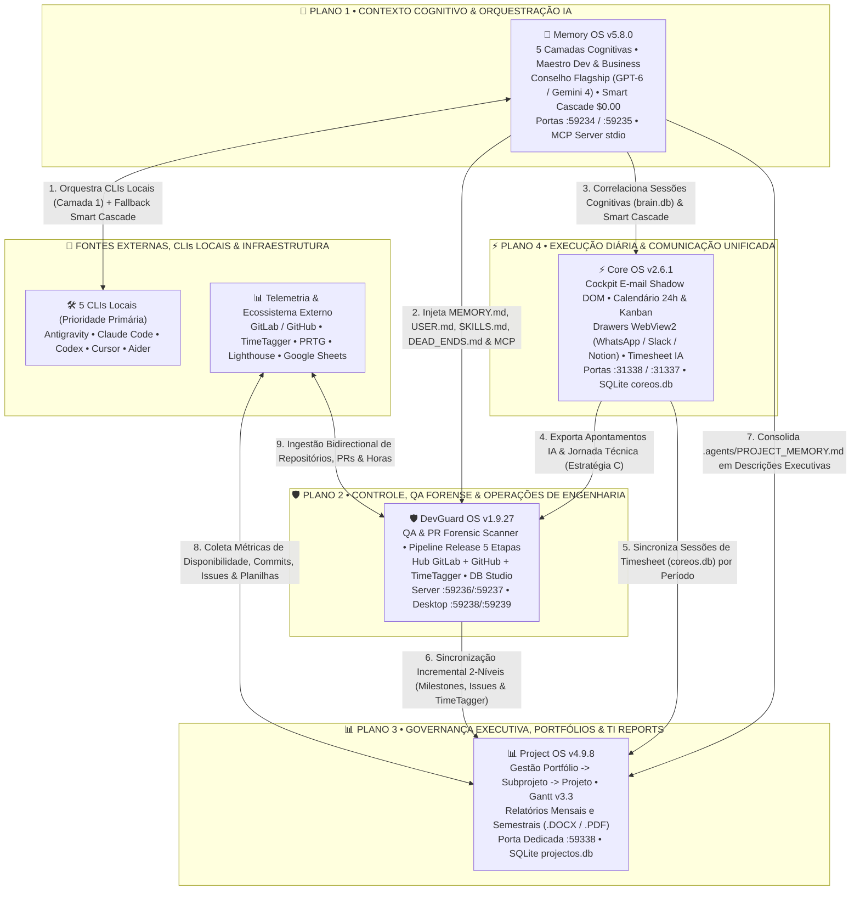

# 🌐 VTI OS SYSTEM — Enterprise AI-Native Software Engineering, Cognitive Memory & Governance Ecosystem

> **Plataforma Corporativa Integrada em Malha Fechada para Engenharia de Software Assistida por IA, Memória Cognitiva Perene, Governança Técnica Zero-Trust, Gestão Executiva de Portfólios e Produtividade de Alta Performance.**
>
> **Propriedade Intelectual & Engenharia:** **VTI** • *Edição Corporativa Consolidada (2026)*

---

## 📋 Visão Geral Institucional

O **VTI OS SYSTEM** é a infraestrutura proprietária de engenharia de software e governança corporativa desenvolvida pela **VTI** para erradicar a fragmentação operacional, a perda de contexto cognitivo e o risco de conformidade em equipes técnicas e executivas de alta performance.

Em operações modernas de tecnologia, engenheiros, arquitetos e executivos enfrentam um abismo estrutural entre quatro mundos desconectados:
1. **O Ambiente de Execução Diária** (e-mails, reuniões, mensageria instantânea, tarefas e apontamento de horas);
2. **O Ambiente de Inteligência Artificial & IDEs** (agentes autônomos e LLMs que sofrem de amnésia entre sessões, alucinam contratos e repetem erros já resolvidos);
3. **O Ambiente de Controle de Qualidade, Git & Segurança** (repositórios, PRs, auditorias de vulnerabilidade, compliance e releases);
4. **O Ambiente de Governança Executiva & SLAs** (portfólios PMBOK/Agile, prestação de contas, faturamento de horas e relatórios gerenciais de TI).

O **VTI OS SYSTEM** unifica esses quatro domínios em uma **arquitetura de malha fechada (*Closed-Loop Governance*)**, onde cada sessão de trabalho, commit, decisão arquitetural, revisão de código e apontamento de horas retroalimenta automaticamente o ecossistema — mantendo **100% de soberania local de dados (*Local-First*)**, **auditoria criptográfica** e **otimização inteligente de custos de IA (`$0.00` Free-Tier Cascade + Prioridade Universal às CLIs locais)**.

---

## 🧭 Os 4 Planos Arquiteturais do Ecossistema VTI

| Plano Arquitetural | Sistema VTI | Versão Atual | Papel no Ecossistema (*System-of-Record*) | Portas & Runtime Nativo |
| :--- | :--- | :---: | :--- | :--- |
| **1. Plano de Contexto, Memória Cognitiva & Orquestração Multi-Agente** | **🧠 Memory OS** | `v5.8.0` | Memória neuro-inspirada em 5 camadas, Conselho Flagship Multi-Modelo, Orquestrador Dual-Mode (`Maestro Dev` & `Maestro Business`) e Motores `Surgical Code` + `Smart Cascade`. | Frontend `:59234` Backend `:59235` MCP `stdio JSON-RPC 2.0` |
| **2. Plano de Controle, QA Forense, Segurança & Operações Git** | **🛡️ DevGuard OS** | `v1.9.27` | Governança contínua de repositórios, Scanner Forense de PR/Branch, Supply-Chain Security, Orquestração Híbrida (`GitLab` + `GitHub` + `TimeTagger` + `Core OS`) e Gatekeeper de Release. | Server `:59236` / `:59237` Desktop `:59238` / `:59239` Tauri v2 + Docker Swarm |
| **3. Plano de Governança Executiva, Portfólios & Relatórios de TI** | **📊 Project OS** | `v4.9.8` | Gestão executiva (`Portfólio -> Subprojeto -> Projeto`), Sincronização Incremental em 2 Níveis com DevGuard/CoreOS/MemoryOS e geração automatizada de Relatórios Mensais/Semestrais de TI (`.docx`/`.pdf`). | Desktop & API `:59338` Tauri v2 + WebView2 SQLite `projectos.db` |
| **4. Plano de Execução Diária, Comunicação Unificada & Timesheet IA** | **⚡ Core OS** | `v2.6.1` | Cockpit executivo *Keyboard-First* com E-mail Superhuman (Shadow DOM), Calendário 24h, Drawers Nativos WebView2 (WhatsApp/Slack/Notion) e Timesheet Inteligente correlacionado por IA. | Frontend `:31338` Backend + WS `:31337` Tauri v2 + WebView2 |

---

## 🏛️ Diagrama Arquitetural e Fluxo de Governança em Malha Fechada

---

## 📦 Repositórios Mestre do Ecossistema VTI

---

### 🧠 1. Memory OS — *Cognitive Memory Infrastructure, Multi-Agent Maestro Studio & Universal Intelligence Gateway*
* **Repositório:** [`MemoryOS`](https://github.com/ProjectOS-system/MemoryOS) | **Versão:** `v5.8.0 (Solo & Enterprise Edition)`
* **Propósito:** Infraestrutura de memória cognitiva cumulativa em 5 camadas neuro-inspiradas, combinada a um Gateway Universal de Inteligência Artificial e ao **Maestro Studio Dual-Mode** para orquestração autônoma de desenvolvimento de software e operações corporativas críticas.

#### 🔬 Arquitetura Cognitiva em 5 Camadas (Neurociência em Código):
1. **Memória de Trabalho (Working Memory — Córtex Pré-Frontal):** Contexto ativo com *Pre-Compress Insight Extraction* antes da compactação de tokens e **Compressão Stacked em Duplo Estágio** (`Terminal Log Pruner` + `Semantic Prose Compressor pt-BR` com sentinela `\u0000MOS_PRESERVE`).
2. **Memória Episódica (Subconsciente — Hipocampo):** Repositório append-only em SQLite (`brain.db` WAL) com **Busca Híbrida RRF 4-Vias (Reciprocal Rank Fusion)** combinando Léxico **FTS5 BM25**, Semântico Vetorial Local **ONNX (`all-MiniLM-L6-v2` 384d)**, Grafo Relacional **GraphRAG (`memory_relations` BFS)** e Tríade de Relevância Temporal de Stanford (Park et al.):
   $$\text{FinalScore} = \text{BM25} \cdot \left( \frac{1}{1 + 0.05 \cdot \text{dias}} \right) \cdot \text{ImportanceScore}$$
3. **Memória Semântica (Neocórtex / Consolidação Noturna):** Conhecimento perene destilado em `USER.md` e `MEMORY.md`, com log bi-temporal `fact_history`, *Write Approval Gate* (`pending_writes`), *Drift Detection* (`SHA-256`) e *Threat Pattern Scanning* contra Prompt Injection e Memory Poisoning.
4. **Memória Ambiental (Memória Implícita por Projeto):** Injeção determinística via `.agents/PROJECT_MEMORY.md` na raiz de cada repositório e bloqueio ativo de regressões via `DEAD_ENDS.md`.
5. **Memória Procedimental (Cerebelo & Gânglios Basais):** Evolução autônoma de skills (`procedural_skills` $\rightarrow$ `SKILLS.md`) e exposição nativa via **Servidor MCP (`mcp_server.js`)** com **17 ferramentas** em protocolo `stdio JSON-RPC 2.0`.

#### ✨ Principais Diferenciais e Funcionalidades (`v5.8.0`):
* **Universal Intelligence Gateway & Conselho Flagship Multi-Modelo (`Human-in-the-Loop v5.1`):** Ferramentas nativas `ai_consult_council`, `ai_dual_code_review` (com injeção obrigatória de `DEAD_ENDS.md` e vereditos estritos) e `ai_adversarial_test_gen`, integrando **OpenAI GPT-6 Flagship** (`gpt-6-luna`, `gpt-6-sol`, `gpt-6.1-sol`, `gpt-6-astra`) e **Google Gemini 4 / 3.8** (`gemini-4-argon`, `gemini-3.8-flash`, `gemini-3.7-flash`, `gemini-3.1-pro-preview`).
* **Módulo MemoryOS Maestro Studio (`Maestro Dev` & `Maestro Business`):**
  * **Prioridade Primária Universal às 5 CLIs Locais (`Camada 1`):** Tanto no modo Desenvolvedor quanto no Corporativo, o Maestro prioriza sempre as CLIs autenticadas localmente (`Google Antigravity CLI`, `Claude Code CLI`, `OpenAI Codex CLI`, `Cursor Agent CLI` e `Aider CLI`), com descoberta dinâmica de modelos reais (`state.vscdb`, `claude.exe`, `~/.codex/config.json`), Heartbeat OAuth pré-vôo (`< 100ms`), `Cumulative Phase Ledger`, Handoff Formal Idempotente e Checkpointing Git atômico.
  * **Visão `Maestro Dev`:** Cockpit de engenharia com 4 views (*Stream & Orquestração*, *Code & Diffs* com auditoria OWASP, *Swarm DAG AST Mesh*, *Time-Travel Checkpoints*), janelas cirúrgicas AST (`> 16 KB`) e motor nativo **`MemoryOS Surgical Code`** (`/surgical-code`, `/surgical-review`, `/surgical-audit`, `/surgical-debt`, `/surgical-metrics`).
  * **Visão `Maestro Business`:** Workspace corporativo Dual-Zone com *Live Document Canvas*, Cofres Efêmeros Governados (`Entrada_Segura/` para lotes de `500 MB` a `5 GB` com Watcher Anti-Lock), Briefing Executivo em Áudio MP3, *Shadow Auditor* com Manifesto Criptográfico `SHA-256 + HMAC-SHA256`, motor **DLP/LGPD** com validação matemática oficial **Módulo 11** (`CPF`/`CNPJ`) e Luhn (`Cartão`), e homologação completa em **27 Cenários Corporativos** (`12 Dev + 15 Business`).
* **`MemoryOS Smart Cascade` & Central Interativa de Chaves Gratuitas (`$0.00` — "Nosso OpenRouter"):**
  * Acionada automaticamente quando as quotas das CLIs locais se esgotam (`429`), por seleção explícita do usuário ou nas rotinas internas do Core.
  * Roteamento *Quality-Gated* em **4 Tiers (`S/A/B/C`)** com *Anti-Degradation Guard*, **45 provedores homologados** (`OpenRouter :free` / `openrouter/free`, `Groq Cloud LPU`, `Google AI Studio`, `Cerebras`, `GitHub Models`, `Ollama Local` sem chave), **Auto-Discovery ao vivo (`GET /models`)**, **Auto-Heal** de modelos descontinuados, fila priorizada (`Subir`/`Descer`) e monitor de telemetria em tempo real (*"Ver Sendo Usado"*).
* **27 Checks de Autodiagnóstico, Power-Aware Scheduler $O(1)$ (`v5.7.2`), Padrão Aberto OKF v0.3 & Cofre Obsidian:** Diagnóstico profundo de saúde em 1-clique, proteção contra disparo em cascata pós-hibernação do Windows e exportação nativa para grafos Markdown.

| Camada | Tecnologia | Porta / Contexto |
| :--- | :--- | :--- |
| **Frontend** | React 19 + Vite 8 | `59234` |
| **Backend Engine** | Node.js + Express 5 (`WriteQueue` + SSE) | `59235` |
| **Desktop Shell** | Tauri v2 Desktop Wrapper (Rust + WebView2) | Windows Native |
| **Database & Search** | SQLite3 (`brain.db` WAL + FTS5 + ONNX 384d + GraphRAG) | `~/.gemini/antigravity/brain/` |
| **Protocolo de Agentes** | Servidor MCP Nativo (`mcp_server.js` — 17 Tools) | `stdio JSON-RPC 2.0` |

---

### 🛡️ 2. DevGuard OS — *Autonomous Code Governance, Forensic PR Scanner, Hybrid Engineering Hub & Release Gatekeeper*
* **Repositório:** [`DevGuardOS`](https://github.com/ProjectOS-system/DevGuardOS) | **Versão:** `v1.9.27 (Dual-Instance: Server Cloud & Desktop Standalone)`
* **Propósito:** Plataforma autônoma de governança de código, auditoria forense de segurança/arquitetura, gestão híbrida de engenharia (`GitLab` + `GitHub` + `TimeTagger` + `Slack` + `CORE OS`) e automação segura de releases.

#### ✨ Principais Diferenciais e Funcionalidades (`v1.9.27`):
* **Arquitetura Dual-Instance (Cloud Server & Desktop Tauri v2):** Opera simultaneamente como **Servidor Corporativo em Docker Swarm / NFS** (`:59236` / `:59237` com `devguard_server.db` e pools PostgreSQL) e como **Aplicativo Desktop Isolado Tauri v2** (`:59238` / `:59239` com `devguard_local.db` e Auto-Healing SQLite).
* **Orquestração Híbrida de Engenharia (`GitLab` + `GitHub` + `TimeTagger` + `CORE OS`):**
  * Hierarquia completa de Demandas (**Portfólio $\rightarrow$ Subprojeto $\rightarrow$ Projeto Autônomo** em `gl_milestones` e `gl_issues` com blindagem relacional anti-colisão ID/IID `findMilestoneByIdOrIid`).
  * **Quadro Kanban Dinâmico** (com expurgo automático de tags de coluna ao concluir tarefas) e **Cronograma Gantt Interativo** com edição inline zero-friction.
  * **Reconciliação Canônica de Horas (`TimeTagger` + `CORE OS`):** Algoritmo de normalização em 3 níveis (`toCanonicalKey`) que vincula apontamentos do TimeTagger e sessões de IA do CORE OS (`CoreOSImportModal` com Estratégia C proporcional) diretamente às tarefas e demandas.
* **Scanner Forense de Branch/PR (`prAuditService.js`) & QA Compliance v2.5 (`auditService.js`):**
  * Inspeção cirúrgica em delta Git (`git diff --numstat`) sob **6 pilares defensivos**: (1) Detecção de **22 padrões de segredos** exclusivamente em linhas adicionadas (`+`), (2) Detecção de **Trojan Source / Homoglyphs Unicode** bidirecionais, (3) Quebra de contratos REST, (4) Bloqueio de binários/arquivos `.env`, (5) Exigência de cobertura de testes no delta e (6) Higiene de `console.log`/`debugger`.
  * **Supply-Chain Security Multi-Gerenciador:** Auditoria profunda em `npm`, `pnpm` e `pip-audit`, incluindo detecção de scripts maliciosos em `preinstall`/`postinstall` e poda de *Dead Code*.
  * **Auditoria Sensível ao Tipo de Projeto (`repoType-aware`):** Pesos dinâmicos para `backend`, `frontend`, `fullstack` ou `mobile` em 16+ linguagens e 11 manifestos de pacotes.
* **Gatekeeper de Release `@ops` & Pipeline Seguro em 5 Etapas (`releasePipelineService.js`):**
  * Atualização automatizada de `CHANGELOG.md`, `README.md` e `API_REFERENCE.md`, seguida por pipeline transacional em 5 estágios com **Smoke Test HTTP pós-deploy** e modo **Dry-Run**.
* **Gestão Zero-Trust de Anexos In-App, Síntese Executiva IA & DevGuard DB Studio:**
  * Upload seguro com UUID v4, hash `SHA-256`, sanitização de `local_path` e preview integrado (`PDF`, `DOCX`, `MD`, `TXT`, imagens).
  * Síntese executiva assíncrona (`projectSummaryService.js`) com detecção de obsolescência via `source_fingerprint` SHA-256, Relatório de Status 100% Relacional (Top 15 entregas reais) e **DB Studio** para gestão visual de bancos PostgreSQL e SQLite.
* **Motor Smart Cascade Custo Zero (`cascadeAiService.js`):** Orquestração gratuita (`Groq Cloud LPU`, `OpenRouter :free`, `Google AI Studio` com herança automática de chave e `Ollama Local`) com compressão dual de contexto (até **81% de economia de tokens**).

| Camada | Tecnologia | Porta / Contexto |
| :--- | :--- | :--- |
| **Server Instance (Cloud/Swarm)** | Node.js + Express (`:59236`) • React + Vite (`:59237`) | `devguard_server.db` + NFS |
| **Desktop Instance (Standalone)** | Tauri v2 + Node.js (`:59238`) • React + Vite (`:59239`) | `devguard_local.db` (Local-First) |
| **Database Studio & Connectors** | SQLite FTS5 + PostgreSQL Pool Manager | Multi-Tenant / Encrypted Secrets |

---

### 📊 3. Project OS — *Executive Portfolio Governance, Multi-Source Synchronization & Automated IT Reporting*
* **Repositório:** [`ProjectManagementSystem`](https://github.com/ProjectOS-system/ProjectManagementSystem) | **Versão:** `v4.9.8 (Tauri v2 Native Desktop)`
* **Propósito:** Plataforma executiva de gestão de portfólios, projetos (PMBOK/Agile), indicadores de infraestrutura e geração automatizada de Relatórios Gerenciais de TI Mensais e Semestrais.

#### ✨ Principais Diferenciais e Funcionalidades (`v4.9.8`):
* **Arquitetura Nativa Tauri v2 + WebView2 em Porta Dedicada (`:59338`):** Migração completa de Electron para **Tauri v2**, reduzindo o instalador para `~5 MB` e o consumo de memória RAM em **80%**, operando na porta exclusiva `:59338` (zero colisão com o DevGuard Desktop) com inicialização silenciosa (`CREATE_NO_WINDOW`).
* **Integração Direta Nativa com DevGuard OS (`v4.9.8` — `DevGuardSyncPanel.jsx`):**
  * Conecta-se diretamente ao banco local `devguard_local.db` (SQLite readonly) ou à API REST em nuvem do DevGuard OS para ingerir **Demandas/Milestones (`gl_milestones`)**, **Tarefas/Issues (`gl_issues`)** e **Apontamentos TimeTagger (`tt_records`)**.
  * **Sincronização Incremental/Diferencial em 2 Níveis ($O(1)$):** Identificação instantânea via `unique_id` determinístico (`devguard_tt_<md5>` e `devguard_i_<id>`) combinada com reconciliação semântica para registros legados, exibindo painel pré-vôo de deltas (`Novos`, `Atualizados`, `Inalterados`), agrupamento sintético de sessões do TimeTagger e **Matriz De $\rightarrow$ Para de Status**.
* **Sincronizador Unificado Core OS & Memory OS (`/sync`):**
  * Extração seletiva de sessões de timesheet do `coreos.db` com filtro por período (`Data Inicial` / `Data Final`) e checkboxes bidirecionais granulares.
  * Leitura automática do `brain.db` e consolidação inteligente de múltiplos arquivos `.agents/PROJECT_MEMORY.md` do Memory OS em descrições executivas prontas para diretoria.
* **Motor de Relatórios Gerenciais de TI Mensais e Semestrais (`/ti-reports`):**
  * Geração automatizada de cadernos executivos em **`.docx` (Word)** e **`.pdf`** com gráficos dinâmicos Recharts renderizados em Base64.
  * Ingestão de métricas reais de disponibilidade do **PRTG** (formato literal preciso, ex: `29d 14h 38m 0s`), auditorias **Google Lighthouse** (Performance, Acessibilidade, Best Practices e SEO) e consolidação semestral automática (`S1: Jan–Jun` e `S2: Jul–Dez`).
* **Sincronização Bilateral com Planilha de TI / Notion Dashboard & Assistente IA FAB v4.0:**
  * Exportação com *Selective Merge* para Google Sheets (`PDCA`, `PROJETOS`, `Relatorios de Disponibilidade`) preservando 100% do histórico de meses anteriores e formatações visuais.
  * Hierarquia executiva `PORTFÓLIO` $\rightarrow$ `SUBPROJETO` $\rightarrow$ `PROJETO` com **Gantt Interativo v3.3** e Assistente IA Global (`Ctrl+Shift+A`) com Cascata Multi-Chaves Gemini 3.x em 9 módulos do sistema.

| Camada | Tecnologia | Porta / Contexto |
| :--- | :--- | :--- |
| **Desktop & Web Host** | Tauri v2 (Rust + WebView2) + React 18 | `59338` (Porta Unificada Isolada) |
| **Backend Engine** | Node.js + Express + `docx` / `jspdf` Engine | `59338` (`/api/*`) |
| **Database Local** | SQLite3 (`projectos.db`) + Conector Readonly `devguard_local.db` & `coreos.db` | `backend/data/projectos.db` |

---

### ⚡ 4. Core OS — *Executive Productivity Cockpit, Superhuman Email, Native WebView2 Drawers & AI Timesheet*
* **Repositório:** [`CoreOS`](https://github.com/ProjectOS-system/CoreOS) | **Versão:** `v2.6.1 (Tauri v2 Native Desktop)`
* **Propósito:** Cockpit executivo de produtividade diária *Keyboard-First* que unifica comunicação crítica (Gmail Multi-Conta, WhatsApp, Slack, Notion), Calendário 24h, Kanban de Tarefas e apontamento automático de horas (Timesheet IA) em uma única superfície nativa de altíssima velocidade.

#### ✨ Principais Diferenciais e Funcionalidades (`v2.6.1`):
* **Cockpit de E-mail Estilo Superhuman Multi-Conta & Inteligência Executiva (`v2.4.1–v2.6.1`):**
  * **Isolamento Físico Shadow DOM (`SandboxedEmailBody`):** Renderização de e-mails HTML complexos sem qualquer vazamento de CSS para a interface da aplicação.
  * **Split Inbox Tático & Higiene de Caixa:** Categorização inteligente (`Important`, `Needs Reply`, `Newsletter`, `Cold`, `vip`), **Reply Zero**, **Cold Email Screener**, **Newsletter Bulk Unsubscriber (`RFC 8058`)** e **Classificação em Lote por Data (`Dry-Run` + `Bulk Apply`)**.
  * **Resumo Executivo Automático (Thread + Anexos):** Síntese instantânea combinando o corpo da thread com a extração textual de anexos (`PDF`, `DOCX`, `XLSX`, `CSV`, `TXT`, `MD`), persistida na tabela `email_thread_state` do SQLite (`< 10ms` na reabertura).
  * **Panorama Diário (`18:30`), Sentinela de Importantes & Activity Dashboard:** Card executivo com KPIs do dia e *Prioridades Sem Atuação*, monitoramento em background com Toast acionável e painel de *Retorno & Silêncio dos Envios* (`Sem Resposta > 48h`).
* **Motores Nativos MemoryOS Surgical Code & Smart Cascade Custo Zero Estrito (`R$ 0,00` — `v2.6.0`):**
  * Orquestração multi-provedor com **Hard-Lock Server-Side `costMode: 'free_only'`** garantindo custo zero absoluto através de **11 provedores** (`Google Gemini / AI Studio Free Tier` unificado, `OpenRouter :free`, `Groq`, `Cerebras`, `GitHub Models`, `Mistral`, `SambaNova`, `NVIDIA NIM`, `Zhipu GLM`, `Ollama Local` e `OpenAI` opcional).
  * **Compressor em Duplo Estágio** (economia de `25%–55%` de tokens preservando valores `R$`, datas, `CPF`/`CNPJ` e blocos de código) e telemetria não-bloqueante via `AiStatusFloatingPill.jsx`.
* **Drawers Nativos WebView2 Estilo Opera com Coexistência Split-View:**
  * Painéis laterais nativos para **WhatsApp Web**, **Slack Multi-Workspace** (com classificador triplo de *Preview Modal In-App* vs. *Download Direto Autenticado*), **Notion** e **Websites Customizados** (PRTG, Grafana, Portainer, Jira).
  * Interceptação de links externos em 3 camadas (`tauri-plugin-opener`), Mute de áudio por serviço, Dark Filter nativo, coordenação de HWND com `ReauthModal` e abertura simultânea lado a lado com o `ComposeModal`.
* **Calendário 24h Multi-Conta, Google Tasks Kanban & Command Palette (`Ctrl+K` + Chords `G+...`):**
  * Paridade 100% entre Agenda Lateral e Página de Calendário (`calendarEventMapper.js`), criação de **Google Meet em 1-Click**, **Briefing Executivo Pré-Reunião com IA**, *Slash Commands* (`/ai`, `/email`, `/task`, `/event`, `/timer`), conformidade **WCAG 2.2 AA** e *Code Splitting* com redução de **~78% no bundle inicial**.
* **Timesheet Inteligente (`Estratégia C` + 4 Métodos de Correlação IA):**
  * Coleta single-pass $O(N)$ de commits Git (**20x–50x mais rápida**), desduplicação matemática de janelas sobrepostas (*Merge de Intervalos*), correlação direta com o `brain.db` do Memory OS, blindagem de fuso horário (`UTC` vs. `UTC-3`) e **Power-Aware Cron Guard $O(1)$** pós-hibernação.

| Camada | Tecnologia | Porta / Contexto |
| :--- | :--- | :--- |
| **Frontend** | React 19 + Vite 5 (Code-Split Lazy Chunks) | `31338` |
| **Backend Engine** | Node.js + Express 5 + WebSockets (`ws`) Dual-Loopback | `31337` |
| **Desktop Shell** | Tauri v2 (Rust + Multi-WebView2 Child Windows) | `%LOCALAPPDATA%\CoreOS\` |
| **Database Local** | SQLite3 (`coreos.db` WAL + `synchronous=NORMAL`) | `%APPDATA%\com.coreos.app\data\` |

---

## 🔗 Matriz de Interoperabilidade e Contratos Técnicos em Malha Fechada

| Origem | Destino | Contrato Técnico / Canal de Integração | Valor Gerado no Ecossistema |
| :--- | :--- | :--- | :--- |
| **🧠 Memory OS** | **IDEs & DevGuard OS** | `mcp_server.js` (`stdio JSON-RPC 2.0` — 17 tools) + Arquivos `.agents/PROJECT_MEMORY.md`, `MEMORY.md`, `SKILLS.md` e `DEAD_ENDS.md`. | Agentes codificam com memória viva do projeto, consultam o Conselho Flagship (`GPT-6`/`Gemini 4`) e nunca repetem erros catalogados em `DEAD_ENDS.md`. |
| **🧠 Memory OS** | **⚡ Core OS** | Leitura SQLite Readonly de `~/.gemini/antigravity/brain/brain.db` + Motor compartilhado `Smart Cascade` & `Surgical Code`. | O Core OS correlaciona automaticamente sessões reais de IA com commits Git para compor o Timesheet sem digitação manual. |
| **⚡ Core OS** | **🛡️ DevGuard OS** | Exportação JSON/REST de sessões e `CoreOSImportModal` com **Estratégia C (Rateio Proporcional)**. | Horas trabalhadas e sessões de IA são distribuídas com precisão matemática entre as Issues e Demandas técnicas do DevGuard OS. |
| **🛡️ DevGuard OS** | **📊 Project OS** | Conector híbrido (`devguard_local.db` SQLite Readonly ou API REST `:59236`/`:59238`) com **Sync Incremental em 2 Níveis (`unique_id` MD5 + Semântico)**. | Demandas (`gl_milestones`), Tarefas (`gl_issues`) e Apontamentos (`tt_records` TimeTagger) alimentam os relatórios executivos e o Gantt do Project OS sem duplicação. |
| **⚡ Core OS & 🧠 Memory OS** | **📊 Project OS** | Painel `/sync` com leitura seletiva de `coreos.db`, `brain.db` e múltiplos `.agents/PROJECT_MEMORY.md`. | Consolida horas executadas e avanços técnicos dos repositórios diretamente nos Relatórios Gerenciais de TI Mensais e Semestrais (`.docx`/`.pdf`). |

---

## 🛡️ Escala de Autonomia Supervisionada (*Human-in-the-Loop*) & Governança Zero-Trust

O **VTI OS SYSTEM** foi desenhado sob o princípio de **Autonomia Supervisionada Determinística**: os agentes executam o trabalho pesado em background, mas toda mutação crítica passa por barreiras formais de verificação:

1. **Conselho Flagship com Consentimento Explícito (`Human-in-the-Loop v5.1`):** Nenhuma revisão arquitetural crítica ou auditoria de código é emulada localmente sem parecer independente dos modelos Flagship (`GPT-6` / `Gemini 4`) precedido de *Pre-Flight Context Assembly* (código-fonte integral + `DEAD_ENDS.md`).
2. **Write Approval Gate Cognitivo (`Memory OS`):** Memórias extraídas com confiança `< 85%` ou detectadas pelo *Threat Pattern Scanner* ficam retidas em staging (`PendingWritesManager.jsx`) aguardando aprovação humana.
3. **Shadow Auditor & DLP/LGPD com Módulo 11 (`Maestro Business`):** Lotes documentais passam por sanitização determinística de `CPF`/`CNPJ` (Módulo 11) e cartões (Luhn), gerando Manifesto Criptográfico `SHA-256 + HMAC-SHA256` e enviando itens com confiança `< 75%` para fila de revisão humana.
4. **Dry-Run & Release Gatekeeper em 5 Etapas (`DevGuard OS` & `Core OS`):** Tanto a classificação em lote de e-mails quanto o pipeline de release e sincronização de demandas oferecem pré-visualização de deltas (*Dry-Run*) e **Smoke Test HTTP** automático com rollback em caso de falha.

---

## 🛠️ Stack Tecnológica Consolidada e Mapa de Portas

| Sistema | Porta Frontend | Porta Backend / API | Runtime Desktop | Banco de Dados Primário |
| :--- | :---: | :---: | :---: | :--- |
| **⚡ Core OS (`v2.6.1`)** | `31338` | `31337` (HTTP + WS) | Tauri v2 + Multi-WebView2 | `coreos.db` (SQLite WAL) |
| **🧠 Memory OS (`v5.8.0`)** | `59234` | `59235` + `stdio MCP` | Tauri v2 Desktop | `brain.db` (SQLite WAL + FTS5 + ONNX 384d) |
| **🛡️ DevGuard OS Server (`v1.9.27`)** | `59237` | `59236` | Docker Swarm + NFS | `devguard_server.db` + PostgreSQL Pools |
| **🛡️ DevGuard OS Desktop (`v1.9.27`)** | `59239` | `59238` | Tauri v2 Desktop | `devguard_local.db` (SQLite Auto-Heal) |
| **📊 Project OS (`v4.9.8`)** | `59338` | `59338` (Unificada) | Tauri v2 Desktop | `projectos.db` (SQLite) |

---

## 💎 Princípios de Engenharia da VTI

* **100% Local-First & Soberania de Dados:** Bancos SQLite em modo WAL, embeddings vetoriais ONNX locais e cofres de segredos criptografados residem na infraestrutura controlada pela VTI, sem dependência de nuvens proprietárias opacas.
* **Prioridade Primária às CLIs Locais + Contingência Gratuita (`$0.00`):** Aproveitamento máximo das assinaturas de CLIs instaladas na máquina do engenheiro (`Camada 1`), com failover transparente para o motor **Smart Cascade** de modelos gratuitos (`OpenRouter :free`, `Groq LPU`, `AI Studio`, `Cerebras`, `GitHub Models`, `Ollama Local`).
* **Performance Nativa Rust + Tauri v2:** Substituição sistemática de wrappers pesados por binários leves em **Tauri v2 + WebView2**, com *Power-Aware Schedulers $O(1)$* e proteção contra travamentos de I/O no Windows.
* **Zero Alucinação por Ancoragem Relacional:** Nenhum relatório de status, changelog ou síntese executiva é gerado no vácuo — toda saída de IA é ancorada em commits reais, issues rastreadas, hashes `SHA-256` e memórias auditadas.

---

  <b>🌐 VTI OS SYSTEM — Empowering Software Engineering with Autonomous AI, Cognitive Memory & Closed-Loop Governance</b> 
  Desenvolvido por <b>Caio Gonçalves</b> • <b>VTI</b> © 2026 — Todos os Direitos Reservados

